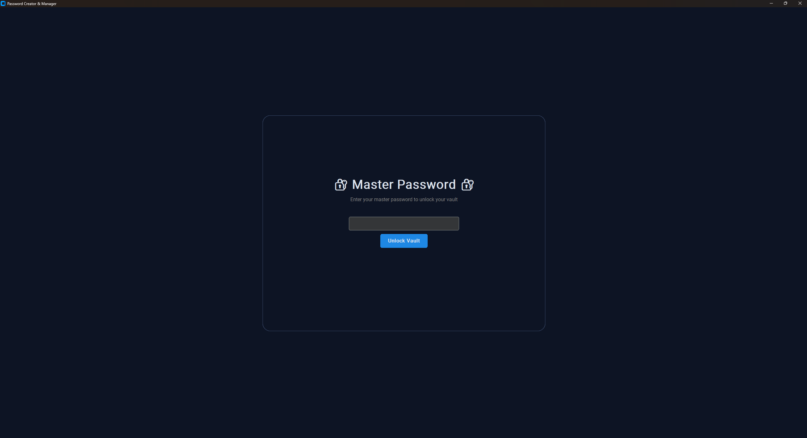
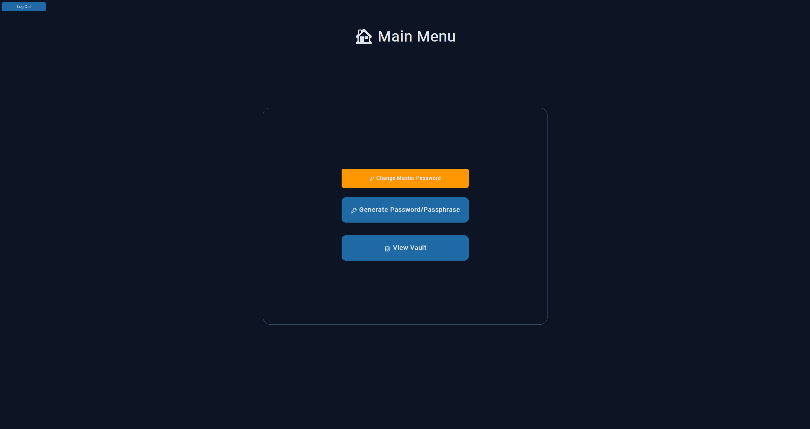
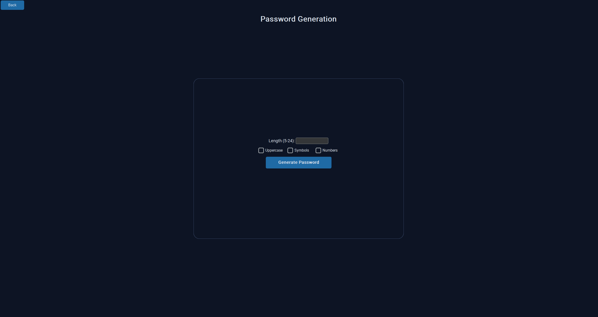

# 🔐 Password Creator & Manager

A secure, desktop-based password manager built with Python, CustomTkinter, and modern cryptography. It generates strong passwords and passphrases, encrypts them with industry-standard algorithms, and stores them in a local vault — all behind a single Argon2id-hashed master password.

# 📸 Screenshots

# ✨ Features

### 🔑 Password & Passphrase Generation
- Generate random passwords with configurable:
  - Length (5–24 characters)
  - Uppercase letters
  - Digits
  - Symbols
- Generate memorable passphrases using `wordfreq` (3–6 words)
- Cryptographically secure randomness via Python's `secrets` module

### 🛡️ Secure Vault Storage
- Every password is encrypted individually with **Fernet** (AES-128-CBC + HMAC)
- Each entry has its own **salt** and key derivation via **PBKDF2HMAC** (100,000 iterations)
- Encrypted vault stored in a local `vault.json` file
- No plaintext passwords ever touch the disk

### 🔐 Master Password Protection
- Master password hashed with **Argon2id** — the winner of the Password Hashing Competition
- Memory-hard and GPU-resistant
- First-time setup flow for new users, login flow for returning users
- Master password is **never stored** — only its Argon2id hash

### 📋 Full Vault Management
- View all saved services in a scrollable list
- Search and filter by service name
- View entry details in a modal popup
- Copy passwords to clipboard with one click
- Edit usernames, URLs, and notes
- Delete entries with confirmation
- Optional notes and URL fields per entry

### 🎨 Modern UI
- Dark theme with custom color palette
- Rounded overlay cards for readability
- Consistent emoji iconography
- Responsive layout across 1600×800 window

---

## 🔒 Security Architecture

This project takes a defense-in-depth approach by having different layers of security.

### Layer 1 — Master Password Hashing (Argon2id)
- Why this is safe: Uses Argon2id to hash the password. Cannot be reversed, memory-hard to slow down GPU brute force.
- The hash for the Master password stored in config.json. 
- Verifies the user.

### Layer 2 - Vault Encryption (Fernet + PBKDF2)
- Why this is safe: to get a decrypted password, the master password as well as its unique salt is required even if the vault.json is stolen.
- (hashed master password + salt) is passed through PBKDF2 to derive the Fernet encryption key.
- PBKDF2 has 100,000 iterations
- encrypted passwords are stored in the vault.json

### What is encrypted?
- Master password | ❌ Not stored | Only its argon2id hash is stored
- Stored password | ✅ Encrypted with Fernet | sensitive and expected to be retrieved 
- Notes | ✅ Encrypted with Fernet | May contain sensitive info
- Usernames | ❌ plain text | Needed for the search function without decryption
- Service names | ❌ plain text | Used for JSON keys
- URLs | ❌ plain | public knowledge

# 🧠 Threat Model

### ✅ Protects Against
- **Server-side data breaches** — nothing sensitive is stored in plaintext
- **Rainbow table attacks** — every hash is salted
- **GPU brute-force** — Argon2id is memory-hard
- **Credential reuse** — each service has a unique password
- **Theft of `vault.json`** — encrypted with the master password
- **Theft of `config.json`** — contains only a one-way Argon2id hash

### ⚠️ Does Not Protect Against
- **Keyloggers** — if the OS is compromised, nothing helps
- **Screen capture / shoulder surfing** — physical security is the user's responsibility
- **Weak master passwords** — cryptography can't fix a user choosing `"password123"`
- **Malware with memory access** — a running process can be inspected
- **Lost master password** — there is no recovery by design

---

# 🛡️ Reliability
- Atomic file writes prevent vault corruption if the app crashes mid-save
- Writes to a temporary file, then atomically renames it into place

---

# 🏗️ Project Structure

1. main.py = Entry point + all UI elements (frontend)
2. generator.py = Password and passphrase generation
3. encrypter.py = Fernet encryption/decryption
4. vault_manager.py = logic for CRUD UI (saving, loading, editing, deleting)
5. config_manager.py = master password hashing and verification

# 💭 Personal Thoughts 
*Note: By the time that I had learned about git and the whole concept of commit, as well as GitHub, the project had already been completed. Hence, as to why my initial commit would be comprised of a complete program. I will keep git and the commit function in mind for future projects.

- **Why I built this**:

I kept receiving email remainders from multiple websites and services I use about changing your password or that there was some sort of data leak and my password is in one of them. I grew tired and annoyed about constantly making new passwords so I wanted some way to automate it. I know that there are other password managers out there that I can use but frankly that just sounded boring to do, that and I don't quite trust any of them.
- **What I learned**:
  - I've learned several things when partaking in this personal project. For one, I didn't know about Python's Fernet encryption method and argon2id for hashing.
  - I did not know about the Salt methodology in cybersecurity. I learned and even witnessed how useful that is when it comes to encrypting data.
  - I learned how important it is to structure my program. dividing my code up into easily understandable files helped a ton with debugging. As longas I know the general area that the error is coming from, I could go to the specific section/file that pertains to that error and start debugging from there.

# 🔧 What I'd do differently
- I'd utilize git and the commit function from the beginning. As it stands I only have one commit history that showcases the complete program. That is not ideal.
- I should put more effort into documentation. Perhaps write a journal that showcases my thoughts during the time and explain what I was thinking, as well as record any sort of decision that I made.

